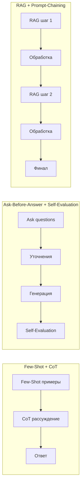
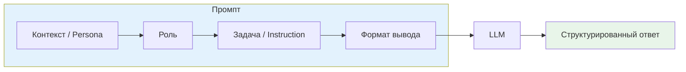
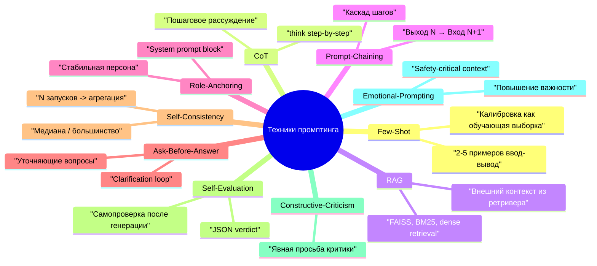

# Лекция 02 – Промпт‑инжиниринг: принципы, шаблоны, стиль и техники

## Введение

Эта лекция переводит архитектурные знания из [[Лекция 01 – Введение в генеративный ИИ, архитектуру LLM и контекст]] в инженерную дисциплину составления промптов. Мы зафиксируем единый шаблон промпта, стиль написания и каталог 10 техник — каждая привязана к радиофизическому примеру.

**Что вы получите:**
- **Четырёхкомпонентный шаблон промпта** (Контекст/Персона → Роль → Задача → Формат) и его компактная форма.
- Стиль: ясность, краткость, последовательность, явный формат, версионирование.
- 10 техник промптинга с радиофизическими примерами: Few-Shot, CoT, RAG, Prompt-Chaining, Role Anchoring, Ask-Before-Answer, Self-Consistency, Self-Evaluation, Constructive Criticism, Emotional Prompting.
- Правила комбинирования техник и соглашения об именовании файлов промптов.
- Базу для [[Лекция 03 – Декомпозиция задач, чейнинг промптов и RAG]] (декомпозиция, чейнинг, RAG) и [[Лекция 04 — Этика, безопасность и оценка результатов]] (Self-Evaluation, Self-Consistency, валидация).

> **Связь с радиофизикой:** Промпт = входной сигнал + заданное начальное состояние фильтра. Few-Shot = обучающая выборка для адаптивного фильтра. CoT = развёртка итераций алгоритма. RAG = внешний эталонный сигнал (pilot tone). Чейнинг = каскад фильтров.

## 1. Что такое промпт‑инжиниринг?

Prompt‑engineering — это дисциплина точного формулирования задачи для больших языковых моделей (LLM). В отличие от «магических фраз», здесь применяется строгий инженерный подход, аналогичный написанию технического задания или API‑контракта.

## 2. Четырёхкомпонентный шаблон
Шаблон содержит **четыре** обязательных компонента. Название «четырёхкомпонентный» отражает современную практику, где формат выделяется в отдельный блок — это критично для парсинга и валидации (см. [[Лекция 04 — Этика, безопасность и оценка результатов]], §2.2 «Проверка схемы»).

| Компонент                | Что описывает                                                                                                   | Как оформить (пример)                                                                                                                        |
| ------------------------ | --------------------------------------------------------------------------------------------------------------- | -------------------------------------------------------------------------------------------------------------------------------------------- |
| **Контекст / Persona**   | «Кем» является модель, в какой предметной области работает, какие ограничения соблюдает.                        | `Ты — senior TypeScript‑разработчик. Контекст: микросервисы на Python 3.12, PostgreSQL 16, без ORM.`                                         |
| **Роль**                 | Явный «линз‑фокус», задающий экспертизу, тон и границы. Формула: **Ты — [роль] + [аудитория] + [ограничение]**. | `Ты — senior backend‑разработчик. Объясни JWT junior‑разработчику, знающему HTTP, без кулинарных аналогий.`                                  |
| **Задача / Instruction** | Одно конкретное действие, сформулированное глаголом.                                                            | `Сгенерируй тесты для функции «calculateTax».`                                                                                               |
| **Формат вывода**        | Жёстко заданный контракт (JSON, Markdown‑таблица, CSV, нумерованный список).                                    | `Ответ в JSON: {"testName":"calculateTax‑edge‑case‑1","input":{"salary":120000},"expected":24000,"description":"Проверка границы 100 kUSD"}` |

> **Mini‑template**
> `Ты — [роль] + [аудитория] + [ограничение]. Контекст: [вводные]. Задача: [одно действие]. Формат: [структура ответа].`

> **Связь с [[Лекция 01]]:** Системный промпт (Контекст + Роль) фиксируется в позиции 0 контекстного окна и задаёт «начальное состояние» авторегрессионного фильтра.

## 3. Руководство по стилю написания промптов (выдержка)

| **Ясность**            | Используйте простой, однозначный язык                                                   |
| ---------------------- | --------------------------------------------------------------------------------------- |
| **Краткость**          | Держите системные промпты ≤ 30 токенов, пользовательские ≤ 150 токенов, когда возможно  |
| **Последовательность** | Переиспользуйте одну и ту же формулу роли (`Ты — [роль] + [аудитория] + [ограничение]`) |
| **Явный формат**       | Никогда не добавляйте «Вот JSON:» – вывод должен начинаться сразу с контракта           |
| **Версионирование**    | Храните промпты в директории `prompts/`, называйте их `v01_<назначение>.md`             |

### Соглашения об именовании
**Зачем это нужно:** единая схема именования позволяет команде мгновенно находить нужный промпт, отслеживать версии через префикс `vXX_`, автоматизировать CI-проверки (линтинг JSON-схем, валидацию формата) и исключить коллизии при слиянии веток. Префиксы `system_`, `example_`, `role_` сразу говорят о типе артефакта без необходимости открывать файл.
- **Системные промпты** → `system_<модуль>.md`
- **Пользовательские промпты / примеры** → `example_<сценарий>.md`
- **Определения ролей** → `role_<имя>.md`

**Пример структуры директории:**
```
prompts/
├── system_radio_engineer.md
├── example_fspl_calculation.md
├── role_radar_engineer.md
└── v01_fspl_fewshot_cot.json
```

### Правила форматирования

1. **Блоки кода** – всегда используйте тройные обратные кавычки с тегом языка (`json`, `python`)
2. **JSON‑контракты** – ключи в `snake_case`, значения типизированы (`string`, `int`, `float`)
3. **Markdown‑таблицы** – используйте синтаксис с вертикальной чертой (`|`), без лишних пробелов

## 4. Техники промпт‑инжиниринга

Ниже — 10 техник с радиофизическими примерами. Заголовки таблицы на русском (правило курса).

| Техника                                  | Суть метода                                                                                      | Как применить (паттерн)                                                         | Радиофизический пример                                                              |
| ---------------------------------------- | ------------------------------------------------------------------------------------------------ | ------------------------------------------------------------------------------- | ----------------------------------------------------------------------------------- |
| **Few‑Shot**                             | Калибрует модель на парах ввод‑вывод                                                             | Включите 2‑5 блоков `Input:` / `Output:` в начале промпта                       | Пример расчёта фильтра: дайте 3 примера «схема → характеристики» перед новой схемой |
| **Chain‑of‑Thought (CoT)**               | Просит модель рассуждать шаг за шагом                                                            | Добавьте `think step‑by‑step` или `Разбей задачу на шаги и объясни каждый`      | Пошаговый расчёт                                                                    |
| **Retrieval‑Augmented Generation (RAG)** | Добавляет внешние документы в контекст                                                           | `Use the following excerpts …` + релевантные фрагменты                          | Извлечение фрагментов примеров из даташита МК перед генерацией кода                 |
| **Prompt‑Chaining**                      | Разбивает задачу на последовательные шаги, передаёт результат каждого в следующий                | Формат: `Шаг 1 → … → Шаг N`, каждый шаг по шаблону §2                           | Каскад: генерация схемы → симуляция в SPICE → оптимизация → отчёт                   |
| **Role Anchoring**                       | Поддерживает персону стабильной в длинных диалогах                                               | Неизменяемый блок идентичности в системном промпте                              | `Ты — инженер радиофизик. Всегда проверяй развязку по S-параметрам.`                |
| **Ask‑Before‑Answer**                    | Модель задаёт уточняющие вопросы перед ответом                                                   | `Ask questions for clarification before generating your answer`                 | Уточнение: «Какой диапазон частот? Мощность? Есть ли LOS?»                          |
| **Self‑Consistency**                     | Несколько запусков одного промпта, выбор наиболее частого ответа (большинство голосов / медиана) | 3‑5 запусков с небольшими вариациями → агрегация (большинство голосов, медиана) | 5 запусков для оценки BER, взятие медианного значения (не Monte-Carlo)              |
| **Self‑Evaluation**                      | После генерации модель проверяет свой вывод                                                      | `Please evaluate your answer and point out possible issues`                     | После генерации кода SDR: «Проверь, есть ли проверка переполнения АЦП»              |
| **Конструктивная критика**               | Прямая просьба о честной критике                                                                 | `Criticize my code` или `Provide a critical review of the solution`             | «Найди ошибки в расчёте диаграммы направленности этой антенны»                      |
| **Эмоциональный промптинг**              | Повышает воспринимаемую важность задачи                                                          | `This is critical for flight safety` или `Максимальная точность — приоритет №1` | «Результат используется в системе посадки ILS — погрешность < 0.1°»                 |

> **Связи:** Few-Shot, CoT, RAG, Prompt-Chaining развиваются в [[Лекция 03]]. Self-Evaluation, Self-Consistency — в [[Лекция 04]].

### Комбинирование техник
Три базовые комбинации:


1. **Few‑Shot + CoT** — few-shot примеры уже содержат пошаговое рассуждение (CoT), модель повторяет паттерн.
2. **Ask‑Before‑Answer + Self‑Evaluation** — сначала уточняющие вопросы, потом генерация, потом самопроверка.
3. **RAG + Prompt‑Chaining** — на каждом шаге цепочки свой ретриверный контекст (см. [[Лекция 03]], §3).

## 5. Практический пример промпта (радиофизический)

**Задача:** Расчёт затухания в свободном пространстве (FSPL) с Few-Shot + CoT.

```
System:
Ты — инженер радиофизики. Контекст: расчёт линейных трасс, ITU-R P.525. Формат: JSON.

User:
Input: Частота 10 GHz, дальность 25 km. Вычисли FSPL в дБ.
```

**Полный промпт с Few-Shot примерами и CoT-триггером:**

```
System:
Ты — инженер радиофизики. Контекст: расчёт линейных трасс, ITU-R P.525. Формат: JSON.

Examples:
Input: Частота 2 GHz, дальность 10 km. Вычисли FSPL в дБ.
Output: {"fspl_db": 100.05, "formula": "20*log10(d_km) + 20*log10(f_GHz) + 92.45", "steps": ["20*log10(10) = 20.00", "20*log10(2) = 6.02", "20.00 + 6.02 + 92.45 = 118.47"], "note": "FSPL = 118.47 дБ"}

Input: Частота 5 GHz, дальность 50 km. Вычисли FSPL в дБ.
Output: {"fspl_db": 133.98, "formula": "20*log10(d_km) + 20*log10(f_GHz) + 92.45", "steps": ["20*log10(50) = 33.98", "20*log10(5) = 13.98", "33.98 + 13.98 + 92.45 = 140.41"], "note": "FSPL = 140.41 дБ"}

User:
Input: Частота 10 GHz, дальность 25 km. Вычисли FSPL в дБ. Think step-by-step and show calculations in "steps" field.
```

**Ожидаемый ответ:**

```json
{
  "fspl_db": 140.41,
  "formula": "20*log10(d_km) + 20*log10(f_GHz) + 92.45",
  "steps": [
    "20*log10(25) = 27.96",
    "20*log10(10) = 20.00",
    "27.96 + 20.00 + 92.45 = 140.41"
  ],
  "note": "FSPL = 140.41 дБ"
}
```

**Происхождение константы 92.45:**  
FSPL (дБ) = $20\log_{10}(d) + 20\log_{10}(f) + 20\log_{10}\left(\frac{4\pi}{c}\right)$  
где $d$ — дальность в метрах, $f$ — частота в Гц, $c = 3\cdot10^8$ м/с.  
Перевод в км и ГГц: $d_{\text{km}} = d/1000$, $f_{\text{GHz}} = f/10^9$.  
$20\log_{10}(4\pi/c) = 20\log_{10}(4\pi/3\cdot10^8) \approx -147.55$ дБ.  
Корректировка на единицы: $20\log_{10}(1000) + 20\log_{10}(10^9) = 60 + 180 = 240$ дБ.  
Итог: $-147.55 + 240 = 92.45$ дБ.  
**Формула верна для $d$ в км, $f$ в ГГц.**

> Пример использует **Few-Shot** (2 пары ввод-вывод в системном промпте) и **CoT** (триггер `Think step-by-step` + поле `steps`). См. [[Лекция 03]] для чейнинга таких расчётов в каскад.

## Вывод

В этой лекции мы зафиксировали:
- **Четырёхкомпонентный шаблон** (Контекст/Персона → Роль → Задача → Формат) — контракт промпта.
- **Стиль**: ясность, краткость, последовательность, явный формат, версионирование в `prompts/`.
- **10 техник** с радиофизическими примерами — каждая решает конкретную проблему надежности/точности.
- **3 комбинации** техник — Few-Shot+CoT, Ask-Before-Answer+Self-Evaluation, RAG+Prompt-Chaining.

Далее, в [[Лекция 03 – Декомпозиция задач, чейнинг промптов и RAG]], мы применим шаблон к **декомпозиции сложных задач**, построим **Prompt-Chaining** пайплайны и интегрируем **RAG** с извлечением контекста на каждом шаге.


---

### Mermaid-диаграммы (заменяют внешние PNG)

#### Четырёхкомпонентный шаблон промпта


#### Обзор 10 техник (карта)

