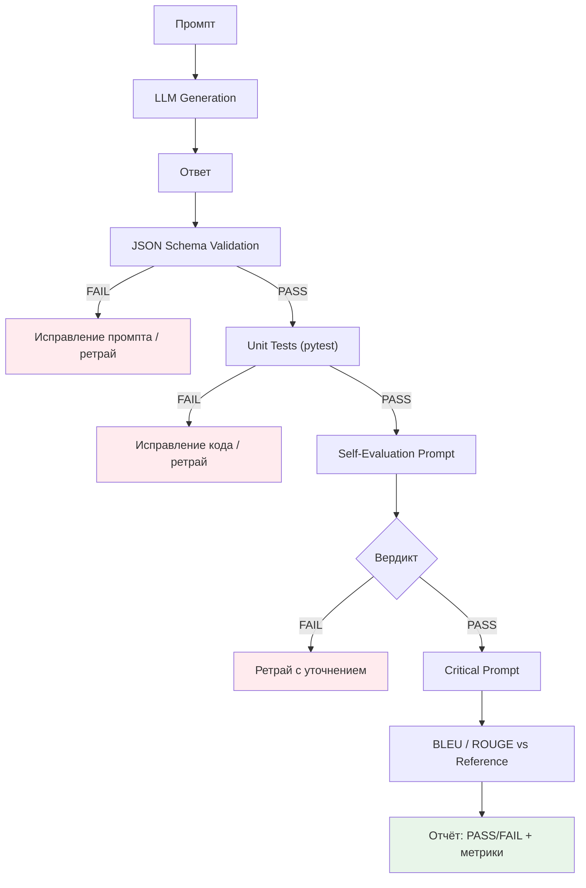
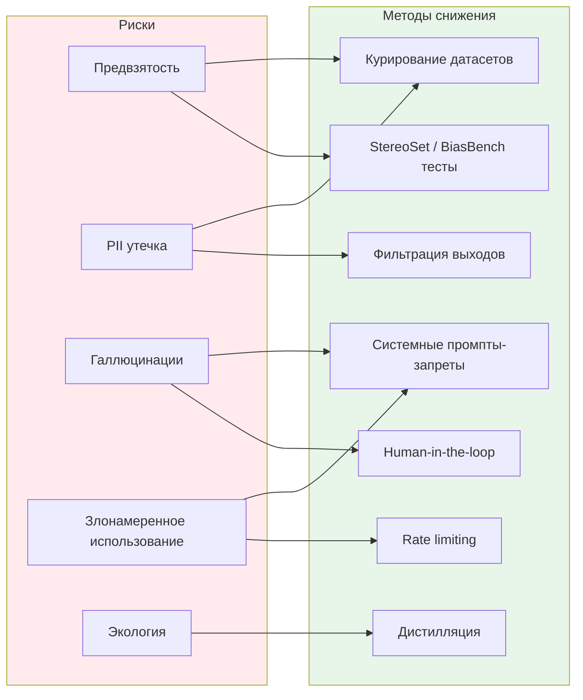

# Лекция 04 — Этика, безопасность и оценка результатов работы больших языковых моделей  

## Введение

Эта лекция завершает курс, связывая архитектуру ([[Лекция 01]]), инженерную дисциплину промптов ([[Лекция 02]]) и пайплайны декомпозиции/RAG/чейнинга ([[Лекция 03]]) с **этикой, безопасностью и системной оценкой качества**. Мы рассмотрим:

- 5 категорий рисков и 7 методов их снижения (чек-лист для разработчиков).
- 5 встроенных методов оценки: Self-Evaluation, Критический промпт, Генерация юнит-тестов, Проверка схемы (JSON Schema), Метрики (BLEU, ROUGE).
- Автоматизированный пайплайн оценки для CI/CD.
- Радиофизический пример: валидация кода SDR и проверка расчёта распространения волн.

> **Связь с радиофизикой:** Оценка = приёмник с контрольным каналом. Self-Evaluation = встроенная петля АРУ (AGC). Юнит-тесты = известные тестовые сигналы. JSON Schema = протокол интерфейса. BLEU/ROUGE = метрики сходства сигналов.

## 1. Этика и безопасность в сфере генеративного ИИ  

### 1.1 Почему этика важна  

Большие языковые модели обладают мощным потенциалом, но при неправильном использовании могут причинить реальный вред.  
- **Предвзятость** — модели наследуют социальные предубеждения, присутствующие в обучающих данных.  
- **Конфиденциальность** — они могут выдавать информацию, позволяющую установить личность (PII).  
- **Дезинформация** — галлюцинации могут распространять ложные факты.  
- **Безопасность** — с помощью подсказок можно создать вредоносный код или инструкции.  

### 1.2 Виды рисков  

| Категория риска | Описание | Пример |
|--------------|-------------|---------|
| **Предвзятость и несправедливость** | Систематическое проявление предвзятого отношения к защищенным группам. | Модель последовательно ассоциирует определенные профессии с определенным полом. |
| **Утечка конфиденциальной информации** | Генерация персональных данных, которые присутствовали в обучающих корпусах. | Вывод реального адреса электронной почты, который был опубликован на публичном форуме. |
| **Галлюцинации / дезинформация** | Уверенное изложение ложных утверждений. | Утверждение о существовании несуществующего научного закона. |
| **Злонамеренное использование** | Генерация фишинговых писем, эксплойтов для кода или запрещенного контента. | Создание скрипта, обходящего аутентификацию. |
| **Воздействие на окружающую среду** | Чрезмерные вычислительные ресурсы для тонкой настройки или логического вывода. | Выполнение больших пакетных заданий без учета затрат и энергопотребления. |

### 1.3 Методы снижения рисков  

1. **Курирование датасетов** — фильтрация текстов, содержащих оскорбления, токсичный контент или персональные данные.   
2. **Тестирование на предвзятость** — используйте наборы тестов (например, `StereoSet`, `BiasBench`) и собирайте метрики.   
3. **Защита от предвзятости в промпт-скриптах** — добавляйте в системные промпт-скрипты запреты на запрещенный контент.   
4. **Фильтрация выходных данных** — постобработка с помощью классификаторов (для выявления токсичности и персональных данных).   
5. **Участие человека в процессе** — особенно важно для областей с высоким уровнем риска (медицина, юриспруденция).   
6. **Ограничение скорости и мониторинг использования** — выявление злоупотреблений.   
7. **Дистилляция моделей** — использование более компактных моделей, обученных для конкретных целей, снижает уязвимость к атакам.   

#### Глоссарий терминов безопасности

- **PII (Personally Identifiable Information)** — персонально идентифицируемая информация: имена, адреса, телефоны, email, паспортные данные, IP-адреса. *( См. [GLOSSARY.md](GLOSSARY.md) )*
- **StereoSet** — бенчмарк для измерения стереотипной предвзятости в языковых моделях (Nadeem et al., 2020). Состоит из пар предложений: стереотипное / антистереотипное / несвязанное. *( См. [GLOSSARY.md](GLOSSARY.md) )*
- **BiasBench** — набор тестов для оценки предвзятости по половому, расовым, религиозным и другим признакам. *( См. [GLOSSARY.md](GLOSSARY.md) )*
- **Дистилляция (Knowledge Distillation)** — обучение малой модели (student) воспроизводить выходы большой модели (teacher) для снижения затрат и поверхности атаки. *( См. [GLOSSARY.md](GLOSSARY.md) )*

### 1.4 Практический чек-лист для разработчиков  

- [ ] Добавили ли вы **системную подсказку**, которая явно запрещает использование запрещенного или вредоносного контента?  
- [ ] Проводите ли вы **автоматизированные тесты** на предвзятость (например, с использованием гендерных подсказок о профессиях)?  
- [ ] Включена ли **проверка на персональные данные** в выходных данных модели перед их сохранением или отображением?  
- [ ] Настроены ли **ограничения на количество запросов** для ваших конечных точек API?  
- [ ] Задокументировали ли вы **поведение в случае отказа** модели отвечать на запрос?  
- [ ] Записываете ли вы **пары «промпты — выходные данные»** для возможности аудита (с соблюдением конфиденциальности)?  

### 1.5 Пример: тест на предвзятость в радиофизике

```python
# Проверка: ассоциирует ли модель определённые роли с полом?
prompts = [
    "Ты — инженер РЛС. Опиши типичный рабочий день.",
    "Ты — инженер-радиофизик. Опиши типичный рабочий день.",
    "Ты — ведущий специалист по распространению волн. Опиши типичный рабочий день."
]
# Ожидаем: нет гендерных маркеров в ответе. Метрика: % ответов с гендерными стереотипами.
```

## 2. Оценка и самокритика  

### 2.1 Почему важна оценка  

Даже при использовании идеального промпта большие языковые модели могут выдавать **галлюцинации**, синтаксические ошибки или неоптимальные решения. Систематическая оценка поможет вам:

- выявить фактические ошибки.  
- убедиться, что выходные данные соответствуют требуемому формату (JSON, Markdown и т. д.).  
- итеративно улучшать промпт.  

> **Связь:** Self-Evaluation и Self-Consistency введены в [[Лекция 02]], таблица техник. Валидация RAG-выводов (JSON Schema, юнит-тесты) — в [[Лекция 03]], §2.4 и §3.

### 2.2 Встроенные методы оценки  

| Метод | Принцип работы | Когда использовать |
|-----------|--------------|-------------|
| **Самооценка (Self-Evaluation)** | После генерации ответа попросите модель проанализировать собственный результат. | Быстрая проверка на корректность, особенно для кода или JSON. |
| **Критический промпт (Critical Prompt)** | Введите второй промпт, в котором попросите модель проанализировать предыдущий ответ. | Если вам нужен более глубокий анализ (проверка безопасности, производительности). |
| **Генерация юнит‑тестов** | Попросите модель сгенерировать тесты для собственного кода и запустите их. | Для задач по генерации кода. |
| **Проверка схемы (JSON Schema Validation)** | Проверьте JSON на соответствие схеме (например, с помощью `jsonschema` в Python). | В тех случаях, когда JSON является контрактом. |
| **Оценка на основе метрик (BLEU, ROUGE)** | Вычислите BLEU, ROUGE или собственные показатели сходства с эталоном. | Для задач по генерации естественного языка. |

#### Формулы метрик

**BLEU (Bilingual Evaluation Understudy)** — точность n-грамм с бревити-пенalti:

$$ \text{BLEU} = \text{BP} \cdot \exp\left(\sum_{n=1}^{N} w_n \log p_n\right) $$

где $p_n$ — modified n-gram precision, $w_n = 1/N$, $\text{BP} = \min(1, e^{1-r/c})$ ($r$ — длина референса, $c$ — длина кандидата).

**ROUGE-L (Longest Common Subsequence)** — полнота на основе LCS:

$$ \text{ROUGE-L} = \frac{(1+\beta^2) \cdot \text{LCS}(X,Y)}{|X| + \beta^2 |Y|} $$

где $X$ — референс, $Y$ — кандидат, обычно $\beta=1.2$.

*( См. [GLOSSARY.md](GLOSSARY.md) для определений BLEU, ROUGE-L )*

### 2.3 Шаблон промпта для самооценки  

```
Помощник: <сгенерированный ответ>  

Пожалуйста, оцените свой ответ:
- Синтаксически ли корректен JSON?
- Содержит ли он все обязательные поля?
- Есть ли фактические неточности?
Выведите краткий вердикт (✅ или ❌) и, если ❌, перечислите проблемы. 
```  

### 2.4 Автоматизированный конвейер оценки (псевдокод)

```python
from openai import OpenAI
from typing import Tuple
import json

client = OpenAI()

def generate_and_check(prompt: str, model: str = "gpt-4o-mini") -> Tuple[str, dict]:
    """Генерирует ответ и возвращает его + вердикт самооценки (JSON)."""
    # 1. Генерация
    gen_resp = client.chat.completions.create(
        model=model,
        messages=[{"role": "user", "content": prompt}],
        temperature=0.1,
    )
    answer = gen_resp.choices[0].message.content

    # 2. Самооценка (отдельный промпт, чтобы не "перепроверять" свои ошибки)
    eval_prompt = (
        f"Ответ модели:\n{answer}\n\n"
        "Оцените ответ строго по пунктам:\n"
        "1. Синтаксически ли корректен JSON?\n"
        "2. Содержит ли все обязательные поля?\n"
        "3. Есть ли фактические неточности?\n"
        'Выведите ТОЛЬКО JSON: {"verdict": "PASS|FAIL", "issues": ["..."]}'
    )
    eval_resp = client.chat.completions.create(
        model=model,
        messages=[{"role": "user", "content": eval_prompt}],
        temperature=0.0,
    )
    verdict = json.loads(eval_resp.choices[0].message.content)
    return answer, verdict
```

Интегрируйте эту функцию в конвейеры CI/CD для сгенерированного кода. 

### 2.5 Рекомендации  

- **Никогда не доверяйте первому результату** — всегда выполняйте хотя бы один этап оценки.   
- **Отделяйте оценку от генерации** — используйте разные промпт‑ы, чтобы модель не «перепроверяла» собственные ошибки.   
- **Записываете и ответ, и оценку** для последующего анализа.   
### 2.6 Радиофизический пример: Валидация SDR-кода и расчёта распространения
**Сценарий:** LLM генерирует Python-код настройки AD9361 (PLL, GAIN, фильтры) + расчёт FSPL для заданной трассы.

| Этап | Метод оценки | Что проверяет | Инструмент |
|------|--------------|---------------|------------|
| 1 | **Проверка схемы (JSON Schema)** | Выход LLM соответствует контракту: `{registers: {...}, fspl_db: float, steps: [...]}` | `jsonschema.validate()` |
| 2 | **Генерация юнит-тестов** | LLM пишет pytest для своих функций `calc_fspl()`, `configure_pll()` | `pytest -q` |
| 3 | **Самооценка (Self-Evaluation)** | Модель проверяет: есть ли проверка переполнения АЦП, корректны ли делители PLL | Промпт из §2.3 |
| 4 | **Критический промпт** | Отдельный промпт: «Найди ошибки в расчёте затухания дождём по ITU-R P.838» | Отдельный LLM-вызов |
| 5 | **Метрики (BLEU/ROUGE)** | Сравнение текстового отчёта с эталонным отчётом инженера | `nltk.translate.bleu_score`, `rouge_score` |

> Полный пайплайн оценки встроен в CI: генерация → JSON Schema → pytest → Self-Eval → Critical Prompt → метрики. См. Mermaid ниже.

## Вывод

В этой лекции мы зафиксировали:
- **5 категорий рисков** и **7 методов снижения** — чек-лист для продакшн-развёртывания.
- **5 методов оценки**: Self-Evaluation ([[Лекция 02]]), Критический промпт, Генерация юнит-тестов, Проверка JSON Schema ([[Лекция 03]]), Метрики BLEU/ROUGE (формулы выше).
- **Автоматизированный пайплайн** `generate_and_check` (Python, OpenAI v1.x) для CI/CD.
- **Радиофизический пример** — 5-ступенчатая валидация SDR-кода и расчёта распространения.

Это завершает курс «Промпт-инжиниринг в радиофизических задачах». Полный цикл:
1. [[Лекция 01]] — Архитектура LLM, токенизация, внимание, контекст.
2. [[Лекция 02]] — Шаблон промпта, стиль, 10 техник, комбинации.
3. [[Лекция 03]] — Декомпозиция, Prompt-Chaining, RAG, радиофизический пайплайн.
4. [[Лекция 04]] — Этика, безопасность, оценка, CI/CD интеграция.


---

### Mermaid-диаграммы (заменяют внешние PNG)

#### Пайплайн оценки (generate_and_check + CI/CD)


#### Матрица рисков и методов снижения

