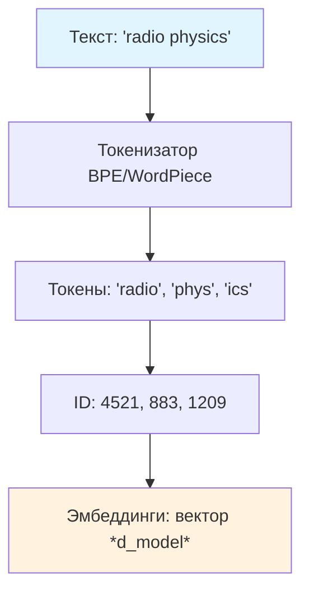
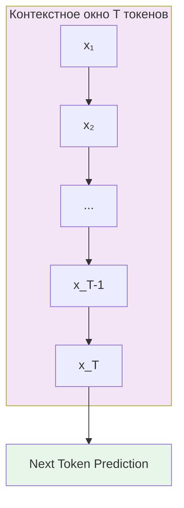
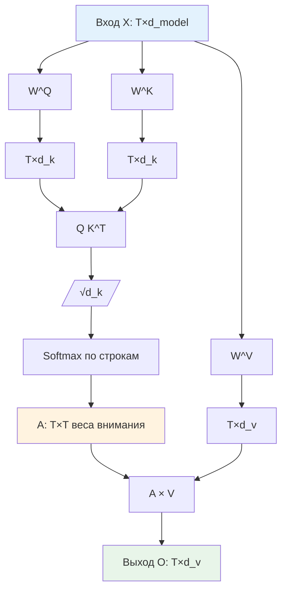

# Лекция 01 – Введение в генеративный ИИ, архитектуру LLM и контекст

## Введение

Эта лекция закладывает фундамент для всего курса «Промпт-инжиниринг в радиофизических задачах». Мы разберём, как устроены большие языковые модели (LLM) «под капотом», почему их поведение можно описать терминами обработки сигналов (авторегрессия, дискретизация, скользящее окно, корреляционная обработка), и как это знание помогает писать эффективные промпты.

**Что вы получите:**
- Понимание токенизации как дискретизации сигнала и её влияния на контекстное окно.
- Математическую интуицию механизма внимания (attention) через Q/K/V-матрицы и формулу $\text{Attention}(Q,K,V) = \text{softmax}\left(\frac{QK^T}{\sqrt{d_k}}\right)V$.
- Чёткое разделение системного и пользовательского промптов и правила работы с контекстным окном.
- Базу для [[Лекция 02 – Промпт‑инжиниринг: принципы, шаблоны, стиль и техники]] (шаблоны промптов), [[Лекция 03 – Декомпозиция задач, чейнинг промптов и RAG]] (RAG и чейнинг) и [[Лекция 04 — Этика, безопасность и оценка результатов]] (оценка и этика).

> LLM — это вероятностный авторегрессионный фильтр. Токенизация = дискретизация + квантование. Контекстное окно = память фильтра. Attention = взвешенная корреляция отсчётов. Промпт = входной сигнал + заданное начальное состояние.

## 1. Что такое генеративный ИИ?

Генеративный ИИ – класс моделей, способных создавать новый контент (текст, код, изображения, аудио) по запросу (промпту). Наиболее распространенный тип сегодня – **большие языковые модели (LLM)**, которые предсказывают следующий токен в последовательности токенов.

### Почему это важно для разработчиков?

- **Помощь в коде** – инструменты вроде GitHub Copilot, CodeLlama, StarCoder
- **Документация и суммаризация** – автоматическая генерация API-документации, заметок к релизу
- **Генерация идей** – мозговой штурм архитектур, написание тестов, создание UI-текстов

## 2. Основные понятия


| **Токен**                             | Минимальная единица, с которой работает модель (кусочек слова, суб‑слово, знак препинания)          |
| ------------------------------------- | --------------------------------------------------------------------------------------------------- |
| **Контекстное окно**                  | Количество недавних токенов, которые модель может учитывать (например, 4 096 токенов)               |
| **Промпт**                            | Текст, который вы даете модели – может содержать системные инструкции, запрос пользователя, примеры |
| **Temperature / Top‑p**               | Параметры сэмплирования, управляющие случайностью против детерминизма                               |
| **Файн‑тьюнинг / Инструкция‑тьюнинг** | Адаптация базовой модели к конкретной предметной области или стилю                                  |

## 3. Устройство LLM и особенности её работы


### 3.1 Что такое LLM (Large Language Model) на самом деле

LLM — это огромный статистический вычислитель, построенный на принципе предсказания следующего элемента последовательности. Вместо того чтобы «понимать» язык, модель оценивает условную вероятность появления каждого возможного токена, учитывая уже наблюдаемые токены:

$$ P(x_t \mid x_{<t}) = \frac{\exp(z_{x_t})}{\sum_{v \in \mathcal{V}} \exp(z_v)} $$

где $z$ — логиты выходного слоя, $\mathcal{V}$ — словарь токенов (размер $|\mathcal{V}| \approx 30\text{k}–128\text{k}$). Эта задача полностью эквивалентна задаче **авторегрессионного фильтра в радиофизике**, где текущий отсчёт сигнала предсказывается на основе предыдущих отсчётов (аналог линейного предсказательного кодирования — **LPC**, Linear Predictive Coding).


### 3.2 Токен и токенизация


**Токен** — элементарная единица ввода/вывода модели (суб-слово, символ, знак препинания). Токенизация — это отображение текста в последовательность целых чисел $x_1, x_2, \dots, x_T$ из словаря $\mathcal{V}$ фиксированного размера (обычно 30k–128k). Аналогия с радиофизикой: **дискретизация по времени + квантование по амплитуде**. Словарь играет роль **кодовой книги** (codebook) векторного квантования.

**Пример для радиофизики:** термин `QPSK` может токенизироваться как `[Q, PSK]` или `[QPS, K]` в зависимости от словаря; `OFDM` → `[OF, DM]`. Это влияет на то, как модель «видит» специализированную терминологию.

#### Токенизация



### 3.3 Контекстное окно


Контекстное окно — это ограниченный набор последних токенов, которые модель может одновременно учитывать. Исторически первые трансформеры (GPT-2, BERT) имели окна 1 024–4 096 токенов. Современные модели (GPT-4, Claude 3, Llama 3, Gemini 1.5) поддерживают **32 000 – 1 000 000+ токенов** за счёт разреженного внимания, **RoPE** (Rotary Positional Embeddings), sliding window attention и других оптимизаций.
Ограничение обусловлено квадратичной сложностью механизма внимания: $O(T^2 \cdot d)$ по вычислениям и $O(T^2)$ по памяти для матрицы внимания $T \times T$.

#### Контекстное окно (скользящее окно)



### 3.4 Веса, параметры и архитектура трансформера

**Веса** — это элементы матриц, которые преобразуют входные эмбеддинги в более абстрактные представления. **Параметры** — общее количество обучаемых скалярных величин в модели; в современных LLM их число измеряется в миллиардах и триллионах.

**Основные блоки параметров в декодерном трансформере (GPT-стиль):**

| Блок | Форма | Число параметров (на слой) |
|------|-------|----------------------------|
| Токенные эмбеддинги | $|\mathcal{V}| \times d_{\text{model}}$ | общие для всех слоёв |
| Позиционные эмбеддинги (или RoPE) | $T_{\text{max}} \times d_{\text{model}}$ или параметры ротации | общие |
| Attention Q/K/V проекции | $3 \times d_{\text{model}} \times d_{\text{model}}$ | $3 d_{\text{model}}^2$ |
| Attention выходная проекция | $d_{\text{model}} \times d_{\text{model}}$ | $d_{\text{model}}^2$ |
| Feed-Forward Network (FFN) | $d_{\text{model}} \to d_{\text{ff}} \to d_{\text{model}}$ | $2 d_{\text{model}} d_{\text{ff}}$ (обычно $d_{\text{ff}}=4 d_{\text{model}}$) |
| LayerNorm (2 на слой) | $2 \times d_{\text{model}}$ | $2 d_{\text{model}}$ |

**Итого на слой:** $\approx 12 d_{\text{model}}^2$ (при $d_{\text{ff}}=4d_{\text{model}}$).  
Для GPT-3 175B: $d_{\text{model}}=12288$, 96 слоёв → $\sim 175\cdot10^9$ параметров.

**Остаточные связи (residual connections):** каждый подслой оборачивается в $x + \text{sublayer}(\text{LayerNorm}(x))$ — критично для обучения глубоких сетей.

### 3.5 Механизм внимания


Механизм внимания (attention) вычисляет взаимную корреляцию между всеми парами токенов внутри контекстного окна, используя запросы (Q), ключи (K) и значения (V).

**Формула масштабированного скалярного произведения внимания (Scaled Dot-Product Attention):**

$$ \text{Attention}(Q, K, V) = \text{softmax}\left(\frac{Q K^T}{\sqrt{d_k}}\right) V $$

Где:
- $Q \in \mathbb{R}^{T \times d_k}$, $K \in \mathbb{R}^{T \times d_k}$, $V \in \mathbb{R}^{T \times d_v}$ — проекции входных эмбеддингов через обучаемые матрицы $W^Q, W^K, W^V$.
- $d_k$ — размерность ключа (обычно $d_{\text{model}} / n_{\text{heads}}$).
- Деление на $\sqrt{d_k}$ стабилизирует градиенты при больших $d_k$ (предотвращает насыщение softmax: вариация элементов $QK^T$ растёт как $d_k$, деление нормализует дисперсию).
- $\text{softmax}$ по строкам даёт веса внимания $A_{ij} \in [0,1]$, $\sum_j A_{ij}=1$ — интерпретируемые как вероятность того, что токен $i$ «обращает внимание» на токен $j$.
- Результат $O = A V \in \mathbb{R}^{T \times d_v}$ — взвешенная сумма значений.

#### Механизм внимания (Scaled Dot-Product)



**Многоголовое внимание (Multi-Head Attention):** параллельные головы с собственными $W^Q_h, W^K_h, W^V_h$, результаты конкатенируются и проецируются через $W^O$.

**Радиофизическая аналогия:** $Q K^T$ — это матрица попарных корреляций (взаимной корреляционной функции) между отсчётами. Softmax выполняет нелинейную нормализацию весов. $V$ — это «сигнал», который пропускается через этот адаптивный фильтр. Многоголовое внимание = банк параллельных корреляционных приёмников с разными ядрами.

> **Связь с [[Лекция 02]], §2:** Системный промпт задаёт «эталонные векторы» K/V в начале последовательности, смещая веса внимания $A_{ij}$ в пользу токенов роли и контекста — эквивалент установки начального состояния адаптивного фильтра.

### 3.6 Природа галлюцинаций

Галлюцинации возникают из‑за того, что модель оперирует лишь вероятностным распределением, а не истинной семантикой. При ограниченном контекстном окне модель может «забыть» важные детали, что усиливает вероятность генерации неверного текста.
**Радиофизическая аналогия:** спектральная утечка (spectral leakage) при неполном наблюдении сигнала — модель «додумывает» недостающие компоненты на основе статистики обучающей выборки.
Подробнее о методах обнаружения и снижения галлюцинаций — в [[Лекция 04 — Этика, безопасность и оценка результатов]].

### 3.7 Позиционные кодировки: RoPE

Современные модели (Llama, GPT-NeoX, Mistral) используют **RoPE (Rotary Positional Embeddings)** вместо абсолютных позиционных эмбеддингов.

**Идея:** повернуть пары измерений Q и K на угол, зависящий от позиции $m$:
$$ Q_m = Q_0 \cdot e^{i m \theta}, \quad K_m = K_0 \cdot e^{i m \theta} $$
где $\theta_d = \theta_{\text{base}}^{-2d/d_{\text{model}}}$ (обычно $\theta_{\text{base}}=10000$).

**Свойства:**
- Относительное положение кодируется в скалярном произведении: $Q_m K_n^T \propto \cos((m-n)\theta)$ — зависит только от разности позиций.
- Нет обучаемых параметров позиции → экстраполяция к длине $> T_{\text{train}}$ работает лучше.
- Совместимо со sliding window attention.

#### RoPE: относительное позиционирование
```mermaid
flowchart TD
    Q0[Q_0: базовый запрос] --> RotQ[Умножение на e^{i m θ_d}]
    K0[K_0: базовый ключ] --> RotK[Умножение на e^{i m θ_d}]
    RotQ --> Qm[Q_m: повернутый запрос]
    RotK --> Km[K_m: повернутый ключ]
    Qm --> Dot[Q_m · K_n^T]
    Km --> Dot
    Dot --> Cos[∝ cos((m-n)θ_d)]
    Cos --> Rel[Зависит только от m-n]
    style Q0 fill:#e3f2fd
    style K0 fill:#e3f2fd
    style Rel fill:#e8f5e9
```


---

## 4. Контекстное окно и системный промпт


### 4.1 Роль контекстного окна

**Контекстное окно** — это набор самых недавних токенов, которые модель может учитывать при генерации следующего токена
Всё, что выходит за пределы этого окна, **невидимо** для модели и не может влиять на ответ

### 4.2 Почему это важно для промптинга

### 4.3 Системный промпт против пользовательского промпта

**Системный промпт** задаёт **персону, роль и высокоуровневое поведение** модели.
**Пользовательский промпт** содержит конкретный запрос, данные или вопрос.

```
System: Ты — senior backend‑разработчик. Твоя задача — давать короткие, технически точные ответы без лишних пояснений.
```


Системный промпт обрабатывается **один раз** в начале сессии и остаётся в начале последовательности токенов, обеспечивая постоянное наличие информации о роли в контексте модели.
Шаблоны системных промптов и роль персоны подробно разбираются в [[Лекция 02 – Промпт‑инжиниринг: принципы, шаблоны, стиль и техники]].

### 4.4 Практические советы

1. **Разместите системный промпт первым** – гарантирует, что роль останется в контекстном окне максимально долго
2. **Держите системный промпт кратким** – каждый токен на счету; 30 токенов обычно достаточно
3. **Обновляйте роль**, если предвидите очень длинное взаимодействие: отправьте короткое напоминание (`Ты по-прежнему senior backend‑разработчик`)
4. **Учитывайте ограничение контекста при RAG** — фрагменты из ретривера съедают токены; см. [[Лекция 03 – Декомпозиция задач, чейнинг промптов и RAG]].

## Вывод

В этой лекции мы установили базовую терминологию и математическую интуицию:
- **Токенизация** = дискретизация + квантование (словарь = кодовая книга).
- **LLM** = авторегрессионный фильтр: $P(x_t \mid x_{<t})$.
- **Контекстное окно** = память фильтра, сложность $O(T^2)$.
- **Attention** = взвешенная корреляция: $\text{softmax}(QK^T/\sqrt{d_k})V$ — банк корреляционных приёмников.
- **RoPE** = относительное позиционирование через комплексное вращение Q/K.
- **Системный промпт** = начальное состояние / приор фильтра.

Далее, в [[Лекция 02 – Промпт‑инжиниринг: принципы, шаблоны, стиль и техники]], мы перейдём от архитектуры к инженерной дисциплине составления промптов: **четырёхкомпонентному шаблону**, стилю и каталогу техник (Few-Shot, CoT, RAG, чейнинг и др.).


---

### Mermaid-диаграммы (заменяют внешние PNG)

#### Токенизация


#### Контекстное окно (скользящее окно)


#### Механизм внимания (Scaled Dot-Product)


#### RoPE: относительное позиционирование
```mermaid
flowchart TD
    Q0[Q_0: базовый запрос] --> RotQ[Умножение на e^{i m θ_d}]
    K0[K_0: базовый ключ] --> RotK[Умножение на e^{i m θ_d}]
    RotQ --> Qm[Q_m: повернутый запрос]
    RotK --> Km[K_m: повернутый ключ]
    Qm --> Dot[Q_m · K_n^T]
    Km --> Dot
    Dot --> Cos[∝ cos((m-n)θ_d)]
    Cos --> Rel[Зависит только от m-n]
    style Q0 fill:#e3f2fd
    style K0 fill:#e3f2fd
    style Rel fill:#e8f5e9
```
