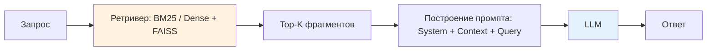
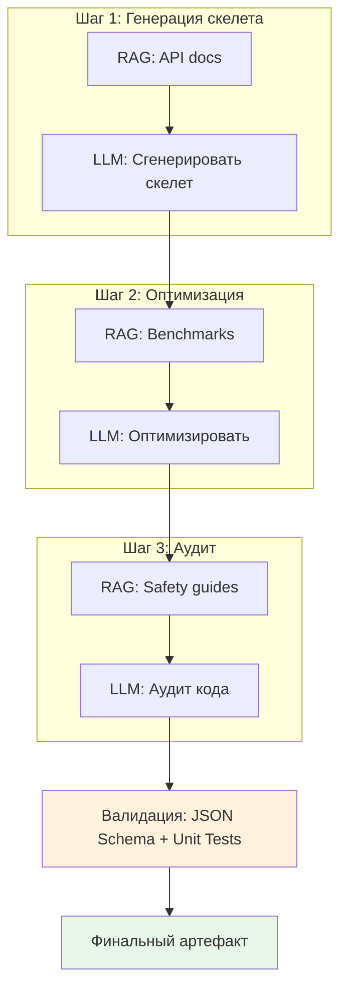
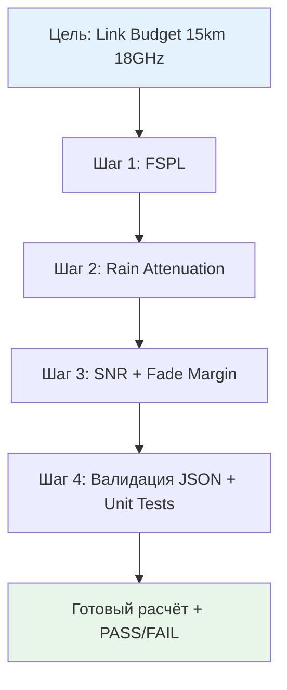

# Лекция 03 – Декомпозиция задач, чейнинг промптов и генерация с дополнением извлечёнными данными (RAG)

## Введение

Эта лекция развивает методы из [[Лекция 02 – Промпт‑инжиниринг: принципы, шаблоны, стиль и техники]] (шаблон промпта, техники Few-Shot, CoT, RAG, Prompt-Chaining) и знания об архитектуре из [[Лекция 01 – Введение в генеративный ИИ, архитектуру LLM и контекст]] (контекстное окно, ограничение токенов). Мы научимся:

- Декомпозировать сложные радиофизические задачи на атомарные подзадачи по шаблону из Лекции 02.
- Строить **Prompt-Chaining** пайплайны, где каждый шаг валидируется (см. [[Лекция 04 — Этика, безопасность и оценка результатов]]).
- Интегрировать **RAG** с извлечением контекста на каждом шаге цепочки.
- Применять это к задачам радиофизики: расчёт бюджета линии связи, настройка PLL, анализ диаграмм направленности.

> **Связь с радиофизикой:** Декомпозиция = разделение задачи на каскад линейных/нелинейных блоков. Чейнинг = последовательная обработка сигнала через блоки. RAG = внедрение эталонных данных (даташиты, стандарты ITU) в каждый блок.

## 1. Декомпозиция задач для ИИ‑агентов

### 1.1 Почему декомпозиция важна
Декомпозиция превращает нечёткую цель («сделай мне РЛС») в последовательность чётких, проверяемых шагов. Это даёт три преимущества:

1. **Одно действие** — задача описывается глаголом («сгенерировать», «проанализировать», «сравнить»).
2. **Ясный контракт** — модель знает, что от неё требуется, и выдаёт предсказуемый результат.
3. **Четырёхкомпонентная структура** (Контекст + Роль + Задача + Формат) — без неё модель «угадывает» ответ (подробнее см. [[Лекция 02]], §2).

### 1.2 Стандартный шаблон декомпозиции

Шаблон полностью совпадает с **четырёхкомпонентным шаблоном из [[Лекция 02]], §2**. Здесь он применяется к каждой атомарной подзадаче в цепочке.

#### Пример

```
Ты — senior Python‑разработчик.  
Контекст: CSV содержит столбцы `name`, `age`.  
Задача: прочитать файл и вернуть список словарей `{name, age}`.  
Формат вывода: JSON‑массив.
```

### 1.3 Decomposition Workflow

1. **Identify the final goal** (what the user ultimately wants).  
2. **Break it into atomic sub‑tasks** – each satisfies the template above.  
3. **Chain the sub‑tasks**: feed the output of step N as the input to step N+1.  
4. **Specify the output format for every step** – this simplifies parsing and aggregation.

#### Full Example (CSV → Filter → JSON string)

| Шаг | Промпт (по шаблону) |
|-----|---------------------|
| 1 | Ты — senior Python‑разработчик.<br>Контекст: CSV содержит столбцы `name`, `age`.<br>Задача: прочитать CSV и вернуть список словарей `{name, age}`.<br>Формат вывода: JSON‑массив. |
| 2 | Ты — senior Python‑разработчик.<br>Контекст: получен массив из шага 1.<br>Задача: отфильтровать элементы, где `age` > 18.<br>Формат вывода: JSON‑массив. |
| 3 | Ты — senior Python‑разработчик.<br>Контекст: отфильтрованный массив из шага 2.<br>Задача: вывести его как строку JSON.<br>Формат вывода: строка JSON. |
## 2. Генерация с дополнением извлечёнными данными (RAG)

### 2.1 Что такое RAG?

RAG сочетает **ретривер** (поиск по коллекции документов) с **генератором** (LLM). Ретривер находит релевантные фрагменты, которые затем внедряются в промпт как дополнительный контекст.

#### Зачем использовать RAG?

- **Актуальная информация** – модель может отвечать на вопросы о недавних событиях.
- **Предметная специфика** – вы можете предоставлять закрытую документацию, спецификации API, кодовые базы.
- **Меньше галлюцинаций** – модель подкрепляет ответ реальным текстом.
Подробнее о природе галлюцинаций см. [[Лекция 01]], §3.6 и [[Лекция 04]], §1.2.

### 2.2 Базовый рабочий процесс RAG

1. **Запрос** – вопрос пользователя.
2. **Ретривер** – например, BM25, плотный векторный поиск (FAISS, Elasticsearch). Возвращает top‑k фрагментов.
3. **Построение промпта** – добавьте извлечённые фрагменты к пользовательскому промпту, опционально с системным промптом, объясняющим их роль.
4. **Генерация** – LLM выдаёт финальный ответ.

#### RAG Pipeline (общий)


Этот паттерн даёт высоко обоснованные, модульные решения, которые легче тестировать и верифицировать.


### 2.3 Схема реализации (Python)

> **Примечание:** Код использует OpenAI Python SDK **v1.x** (`openai>=1.0.0`).

```python
from sentence_transformers import SentenceTransformer
import faiss
from openai import OpenAI
from typing import List

# 1. Encode documents
model = SentenceTransformer('all-MiniLM-L6-v2')

# Пример корпуса для радиофизики: фрагменты даташитов, стандарты ITU, статьи
corpus: List[str] = [
    "AD9361 PLL configuration: ...",
    "ITU-R P.525 free-space path loss formula: ...",
    "Antenna pattern measurement procedure: ...",
]
doc_embeddings = model.encode(corpus)
index = faiss.IndexFlatL2(doc_embeddings.shape[1])
index.add(doc_embeddings)
client = OpenAI()

def retrieve(query: str, k: int = 3) -> List[str]:
    q_emb = model.encode([query])
    _, I = index.search(q_emb, k)
    return [corpus[i] for i in I[0]]

def generate_answer(query: str) -> str:
    passages = retrieve(query)
    system = "Ты — инженер радиофизики. Используй приведённые фрагменты как авторитетный источник."
    prompt = f"{system}\nRetrieved passages:\n" + "\n".join(f"{i+1}. {p}" for i, p in enumerate(passages)) + f"\n\nUser: {query}"
    response = client.chat.completions.create(
        model="gpt-4o-mini",
        messages=[{"role": "user", "content": prompt}],
        temperature=0.1,
    )
    return response.choices[0].message.content
```

### 2.4 Формулы ретривера

**BM25 (Okapi BM25)** — вероятностная ранжирующая функция:

$$ \text{score}(D,Q) = \sum_{i=1}^{n} \text{IDF}(q_i) \cdot \frac{f(q_i,D) \cdot (k_1 + 1)}{f(q_i,D) + k_1 \cdot (1 - b + b \cdot \frac{|D|}{\text{avgdl}})} $$

где $f(q_i,D)$ — частота термина в документе, $|D|$ — длина документа, $\text{avgdl}$ — средняя длина, $k_1 \approx 1.2$, $b \approx 0.75$.

**Dense Retrieval (cosine similarity)** — для эмбеддингов $e_q, e_d \in \mathbb{R}^d$:

$$ \text{sim}(q,d) = \frac{e_q \cdot e_d}{\|e_q\| \|e_d\|} = \cos(\theta) $$

FAISS использует индексы (FlatL2, IVF, HNSW) для приближённого поиска ближайших соседей в этом пространстве.

### 2.5 Советы и подводные камни (RAG)

| Tip                                                           | Reason                                                     |
| ------------------------------------------------------------- | ---------------------------------------------------------- |
| **Ограничьте количество фрагментов** (3‑5)                    | Держит потребление токенов низким и уменьшает шум          |
| **Добавьте чёткую инструкцию**, что фрагменты *авторитетны*   | Предотвращает игнорирование их моделью                     |
| **Валидируйте итоговый вывод** (JSON‑схема, юнит‑тесты)       | Гарантирует, что извлечённые данные использованы правильно |
| **Обновляйте индекс** при изменении документов                | Поддерживает базу знаний актуальной                        |

## 3. Комбинирование декомпозиции и RAG



Вы можете извлекать внешние знания **на каждом шаге** цепочечного рабочего процесса. Например:

1. **Шаг 1** – Извлеките документацию API, затем попросите модель сгенерировать скелет функции
2. **Шаг 2** – Извлеките бенчмарки производительности, затем попросите модель предложить оптимизации
3. **Шаг 3** – Извлеките руководства по безопасности, затем попросите модель зааудить сгенерированный код

### 3.1 Радиофизический пример: Расчёт бюджета линии связи (Link Budget)

**Целевая задача:** Полный расчёт затухания и запаса по шум для трассы 15 км, 18 GHz, дождь ITU-R P.838.

| Шаг | Подзадача (по шаблону Лекции 02) | RAG-источник |
|-----|-----------------------------------|--------------|
| 1 | **Роль:** Инженер РЛС. **Контекст:** ITU-R P.525 (FSPL), P.838 (дождь). **Задача:** Вычислить FSPL. **Формат:** JSON `{fspl_db, steps}` | ITU-R P.525 формула |
| 2 | **Роль:** Инженер РЛС. **Контекст:** Результат шага 1, ITU-R P.838. **Задача:** Добавить затухание от дождя. **Формат:** JSON `{rain_db, total_db, steps}` | ITU-R P.838 коэффициенты |
| 3 | **Роль:** Инженер РЛС. **Контекст:** Результат шага 2, параметры приёмника (NF, BW). **Задача:** Вычислить SNR и fade margin. **Формат:** JSON `{snr_db, fade_margin_db, verdict}` | Приёмник даташит, ITU-R P.530 |
| 4 | **Роль:** QA инженер. **Контекст:** Результат шага 3. **Задача:** Проверить по JSON-схеме, запустить юнит-тесты. **Формат:** PASS/FAIL | Схема JSON, тесты |

> Этот пайплайн реализует паттерн **RAG + Prompt-Chaining** из [[Лекция 02]], § «Комбинирование техник», комбо 3. Валидация на шаге 4 — см. [[Лекция 04]], §2.2.

#### Decomposition Workflow (4 шага)



## Вывод

В этой лекции мы рассмотрели:
- **Декомпозицию** по четырёхкомпонентному шаблону ([[Лекция 02]], §2) — каждое атомарное действие имеет Контекст, Роль, Задачу, Формат.
- **Prompt-Chaining** — каскад шагов, где выход N становится входом N+1, с явными контрактами.
- **RAG** — ретривер (BM25 / dense retrieval + FAISS) + генератор; формулы BM25 и cosine similarity даны выше.
- **Комбинирование** — извлечение релевантного контекста на каждом шаге цепочки (радиофизический пример: Link Budget в 4 шага).
- **Валидацию** — JSON Schema + юнит-тесты на финальном шаге (подробнее в [[Лекция 04]]).

Далее, в [[Лекция 04 — Этика, безопасность и оценка результатов]], мы разберём системные методы оценки (Self-Evaluation, критический промпт, генерация тестов, проверка схемы, метрики BLEU/ROUGE) и этические рамки применения LLM в радиофизических системах.


---

### Mermaid-диаграммы (заменяют внешние PNG)

#### Decomposition Workflow (4 шага)


#### RAG Pipeline (общий)

Этот паттерн даёт высоко обоснованные, модульные решения, которые легче тестировать и верифицировать.